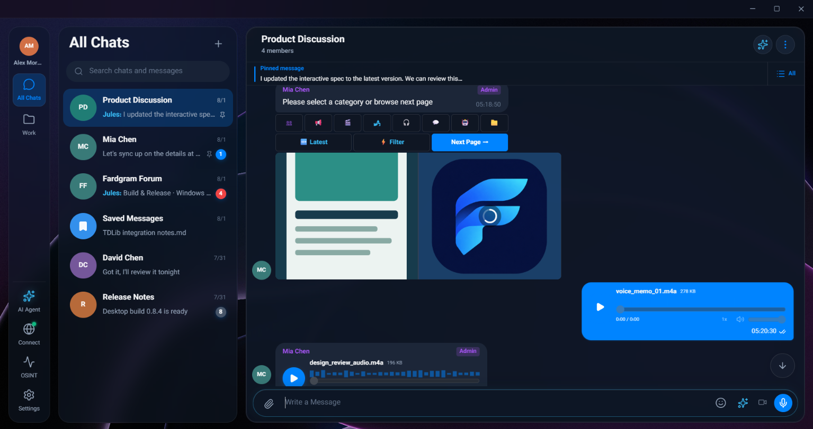
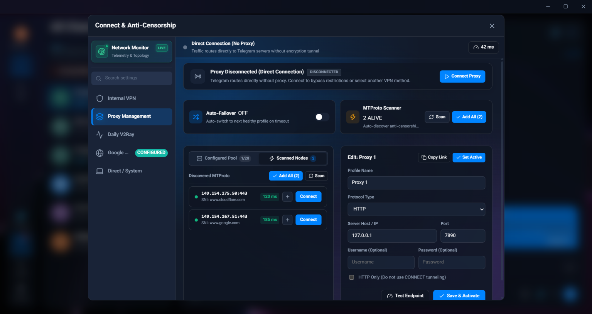
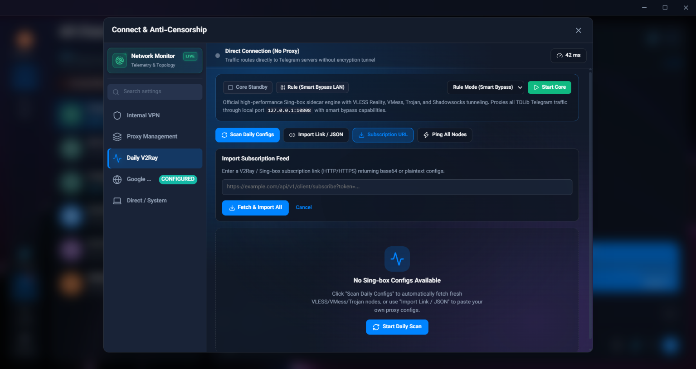
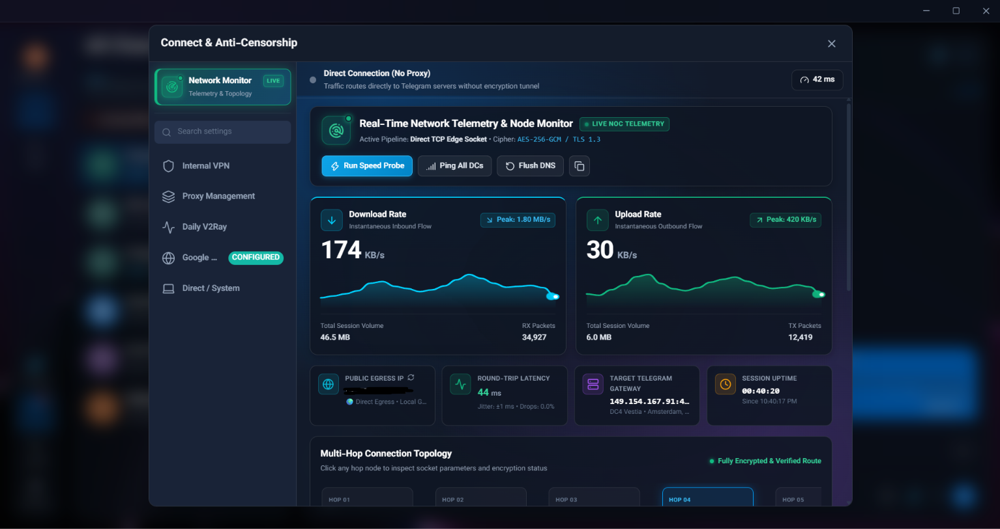
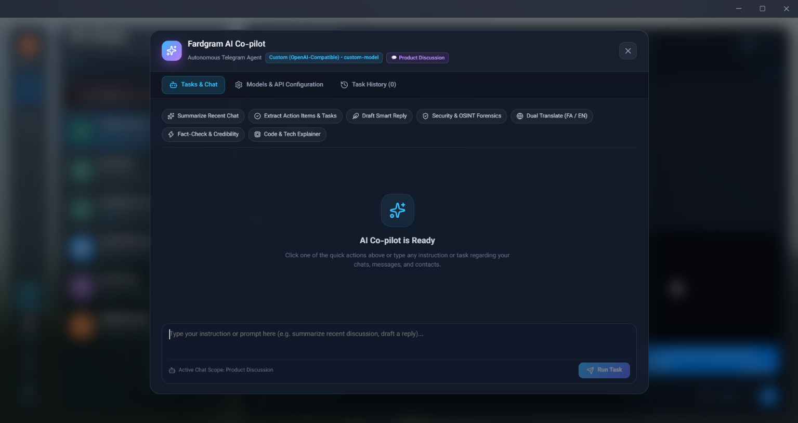
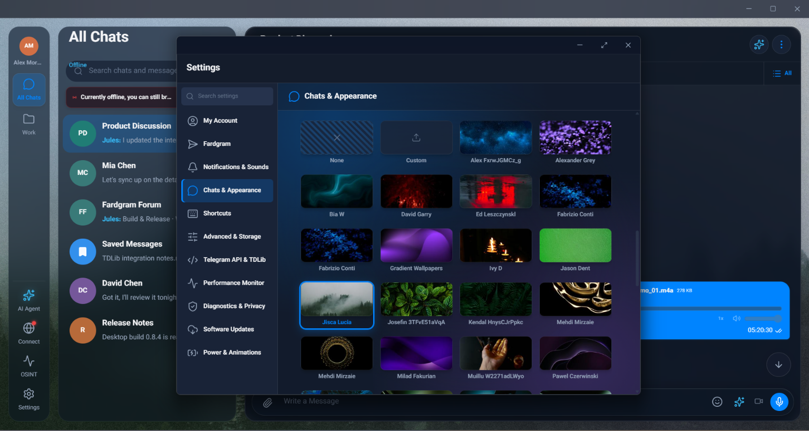
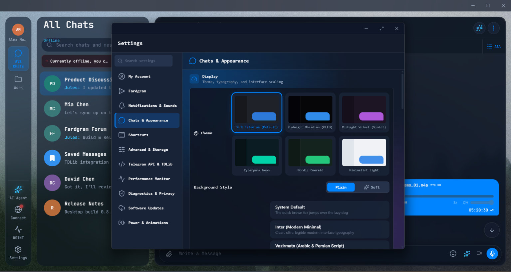
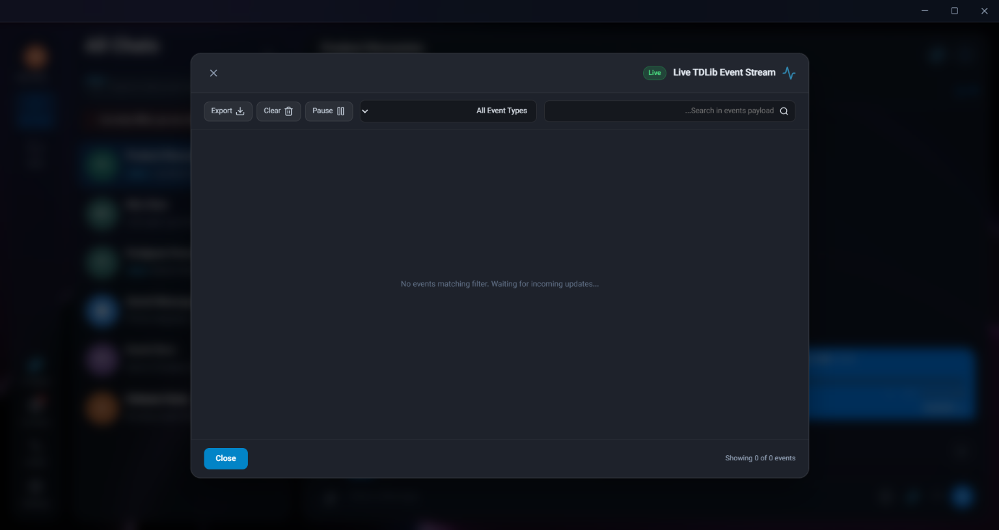
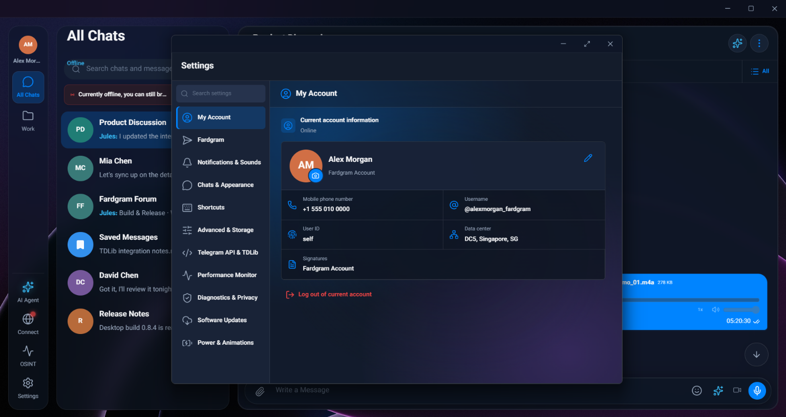

<div align="center">

  

  # Fardgram (فاردگرام)

  **Next-Generation Desktop Telegram Client built with Tauri 2, React 19, TypeScript & TDLib.**  
  *Engineered for Uncompromising Privacy, Built-in Anti-Censorship, Real-Time Network Telemetry & Autonomous AI Assistance.*

  <p align="center">
    <a href="https://github.com/amirrezamortazavifard/Fardgram/releases"></a>
    <a href="LICENSE"></a>
    <a href="https://tauri.app/"></a>
    <a href="https://react.dev/"></a>
    <a href="https://www.typescriptlang.org/"></a>
    <a href="https://core.telegram.org/tdlib"></a>
  </p>

  <p align="center">
    <a href="#-key-features">Key Features</a> •
    <a href="#-visual-showcase">Screenshots</a> •
    <a href="#-anti-censorship--vpn-suite">Anti-Censorship</a> •
    <a href="#-autonomous-ai-co-pilot">AI Co-pilot</a> •
    <a href="#-installation--portable-builds">Download</a> •
    <a href="#-developer-quickstart">Development</a> •
    <a href="#-architecture">Architecture</a>
  </p>

  <br />

  [](https://github.com/amirrezamortazavifard/Fardgram)

</div>

---

## 🌟 Overview

**Fardgram** is a state-of-the-art, high-performance desktop client for **Telegram**. Combining the lightweight native speed of **Tauri 2 (Rust)** and the official **Telegram Database Library (TDLib)** with an ultra-responsive **React 19 + TypeScript** interface, Fardgram delivers a desktop messaging experience built for privacy enthusiasts, power users, and users living under strict internet censorship.

Unlike standard Telegram clients, Fardgram embeds a full **Anti-Censorship & VPN sidecar engine** (Sing-box, V2Ray, VLESS Reality, MTProto Auto-Scanner), **real-time network telemetry graphs**, an **autonomous AI Co-pilot** with OSINT forensic tools, and **zero-telemetry, local DPAPI-encrypted storage**.

---

## ✨ Key Features

### 🛡️ 1. Built-in Anti-Censorship & Stealth VPN
- **Sing-box Sidecar Engine**: Native support for **VLESS Reality**, **VMess**, **Trojan**, and **Shadowsocks** tunneling directly from within the desktop client.
- **Smart Bypass LAN**: Intelligently routes domestic traffic directly while tunneling restricted Telegram connections through high-speed proxies.
- **Automated MTProto Scanner**: Discovers, benchmarks live latency (ms), and auto-connects to verified, working MTProto proxies.
- **Auto-Failover System**: Seamlessly switches to the next healthy node when latency spikes or timeouts occur.
- **Subscription Feed Ingestion**: One-click import for V2Ray and Sing-box subscription links with automatic node refresh.

### 📊 2. Real-Time Network Telemetry & Node Monitor
- **Live Bandwidth Meters**: Interactive SVG telemetry graphs tracking instant download/upload flows with peak throughput metrics.
- **Connection Diagnostics**: Precision round-trip latency (RTT) tracking, jitter analysis, packet loss indicators, and session volume telemetry.
- **Target Gateway & Hop Tracer**: Detailed multi-hop connection topology mapping your connection from local client to Telegram DC edge sockets.

### 🤖 3. Autonomous AI Co-pilot & OSINT Forensics
- **Smart Chat Summarizer**: Instantly digest dense group chats and channel posts into executive bullet points.
- **Action Items & Task Extraction**: Automatically pull todos, meeting dates, deadlines, and deliverables from conversation history.
- **OSINT Forensics & Security Audit**: Analyze links, sender credibility, channel legitimacy, and metadata risks.
- **Dual Translation (FA ⇄ EN)**: Professional bilingual translation between Persian, English, and other languages.
- **Bring Your Own Model (BYOK)**: Connect any OpenAI-compatible API (OpenAI, Claude, DeepSeek, Local Ollama, or vLLM).

### 🎨 4. Aesthetic Design & Theme Studio
- **Curated Theme Palettes**:
  - 🌌 **Dark Titanium** (Default high-contrast dark mode)
  - 🖤 **Midnight Obsidian** (True pure black optimized for OLED displays)
  - 💜 **Midnight Velvet** (Luxury deep violet accents)
  - ⚡ **Cyberpunk Neon** (Vibrant electric cyberpunk styling)
  - 🌿 **Nordic Emerald** (Calming forest and botanical hues)
  - ☀️ **Minimalist Light** (Crisp, clean high-readability light theme)
- **Typography Engine**: Integrated support for **Inter** (modern digital sans) and **Vazirmatn** (superb Arabic and Persian typography).
- **Curated Wallpapers**: Handcrafted artistic backgrounds with dynamic glassmorphism and acrylic blurs.

### 💬 5. Advanced Daily Messaging
- **Full Media Hub**: Waveform audio scrubbers, voice memos, native video player, photo albums, and interactive sticker picker.
- **Mathematical KaTeX Rendering**: Clean formatting of mathematical expressions ($E = mc^2$, matrices, calculus) right inside message bubbles.
- **Rich Forum Topics & Supergroups**: Dedicated topic view for massive communities with pinned threads, closed topics, and badge counts.
- **Interactive Bots & Inline Keyboards**: Seamless bot execution with dynamic callback queries and custom inline button keyboards.

### 🔒 6. Military-Grade Privacy & Local Security
- **Local DPAPI Encryption**: Cryptographic keys, account metadata, proxy credentials, and cache indexes are encrypted using Windows DPAPI.
- **Zero Third-Party Telemetry**: No tracking, no analytical scripts, no analytics telemetry sent outside your private TDLib session.
- **Live TDLib Event Stream**: Inspect every incoming and outgoing TDLib update event in real-time with developer-grade export tools.

---

## 📸 Visual Showcase

<div align="center">

### Main Conversation & Rich Media
*Pinned announcements, KaTeX equations, waveform audio player, and interactive bot keyboards.*  


<br />

### Anti-Censorship & Proxy Management
*MTProto scanner with live ping latency, automatic node discovery, and instant failover.*  


<br />

### Sing-box & V2Ray Sidecar Engine
*VLESS Reality, VMess, Trojan tunneling with smart LAN bypass and subscription feed import.*  


<br />

### Real-Time Network Telemetry
*Live NOC telemetry, download/upload throughput charts, target DC gateways, and hop topology.*  


<br />

### Autonomous AI Co-pilot
*AI assistant with chat summarization, task extraction, OSINT forensics, and translation.*  


<br />

### Custom Themes & Wallpaper Gallery
*High-resolution wallpaper collection and dual-theme customization.*  


<br />

### Theme Studio & Typography
*Switch between OLED Obsidian, Cyberpunk, Nordic Emerald, and custom fonts (Inter / Vazirmatn).*  


<br />

### Live TDLib Diagnostic Event Stream
*Real-time inspection of raw TDLib events for security audits and protocol debugging.*  


<br />

### Account & Storage Center
*Multi-account session info, Telegram DC location, and DPAPI-encrypted cache management.*  


</div>

---

## 🚀 Installation & Portable Builds

### Pre-built Portable Package (Windows x64)
Download the latest pre-compiled portable ZIP from the **[GitHub Releases](https://github.com/amirrezamortazavifard/Fardgram/releases)** page.

1. Extract `Fardgram-vX.Y.Z-portable.zip` to any folder (e.g. `D:\Fardgram` or USB flash drive).
2. Run `Fardgram.exe`.
3. Account databases and encrypted configurations are stored locally in `data/`, making it 100% portable across PCs.

---

## 💻 Developer Quickstart

### Prerequisites
- **Node.js** >= 20.x
- **Rust** >= 1.80 with `msvc` toolchain
- **Visual Studio 2022 Build Tools** (C++ Desktop Development workload)

### 1. Clone & Install Dependencies

```powershell
git clone https://github.com/amirrezamortazavifard/Fardgram.git
cd Fardgram
npm install
```

### 2. Browser Development (Instant Mock Runtime)
You can run the full frontend UI inside any web browser without compiling Rust or TDLib:

```powershell
npm run dev
```
Open `http://127.0.0.1:1420/` in your browser.  
> **Tip**: Toggle Demo Mode with `Ctrl + Shift + D` to explore pre-populated chats, forum topics, and media!

### 3. Native Desktop Development (Tauri 2 + TDLib)

Fetch the pinned Windows x64 TDLib runtime binaries:

```powershell
npm run tdlib:fetch
```

Configure your `.env` file:

```env
VITE_TELEGRAM_TRANSPORT=tauri
NOTGRAM_API_ID=your_telegram_api_id
NOTGRAM_API_HASH=your_telegram_api_hash
```

Launch the Tauri 2 desktop application:

```powershell
npm run tauri dev
```

---

## 🛠️ Build Commands

| Command | Description |
| :--- | :--- |
| `npm run dev` | Starts the Vite development server with instant HMR |
| `npm run build` | Compiles TypeScript and builds optimized production web bundle |
| `npm run tauri dev` | Launches the native Tauri 2 desktop shell with live file watching |
| `npm run build:portable` | Builds a standalone, portable Windows x64 distribution under `artifacts/` |
| `npm run publish:installer` | Generates official signed NSIS Windows installer package |
| `npm run tdlib:fetch` | Downloads and cryptographically verifies pinned TDLib C++ binaries |
| `npm run tdlib:build` | Compiles TDLib from official source using MSVC and vcpkg |
| `npm test` | Runs comprehensive Vitest unit test suite |
| `npm run test:e2e` | Runs Playwright headless end-to-end integration test suite |
| `npm run check` | Runs full formatting, linting, TypeScript type-check, and Rust tests |

---

## 🏗️ Architecture

```text
┌────────────────────────────────────────────────────────────────────────┐
│                        React 19 + TypeScript UI                         │
│   (Chat Lists, Forum Topics, Rich Media, Telemetry, AI Agent, Themes)  │
└───────────────────────────────────┬────────────────────────────────────┘
                                    │ Tauri v2 IPC (Events & Commands)
┌───────────────────────────────────▼────────────────────────────────────┐
│                         Tauri 2 Rust Core                              │
│   ┌───────────────────────────────┴────────────────────────────────┐   │
│   │                                                                │   │
│   ▼                                                                ▼   │
│ ┌─────────────────────────┐                      ┌───────────────────┐ │
│ │  TDLib Dynamic Loader   │                      │ Sing-box / V2Ray  │ │
│ │  (C++ tdjson.dll bridge)│                      │ Sidecar Process   │ │
│ └────────────┬────────────┘                      └─────────┬─────────┘ │
└──────────────┼─────────────────────────────────────────────┼───────────┘
               │                                             │
               ▼                                             ▼
        Telegram Servers                               VLESS / VMess /
       (Direct / MTProto)                            Trojan Stealth Mesh
```

- **Frontend (`src/`)**: Built on React 19, Zustand stores, Tailwind CSS, Lucide icons, and KaTeX.
- **Tauri Core (`src-tauri/`)**: High-performance Rust bridge handling memory-safe IPC, native file dialogues, system tray, and DPAPI key management.
- **TDLib Integration**: Pinned to official Telegram Database Library v1.8.x with asynchronous `td_send` and non-blocking worker receive loops.
- **Security & Storage**: Per-account database encryption keys protected by Windows DPAPI; zero plain-text storage of credentials or tokens.

---

## 🏷️ GitHub Topics & SEO Tags

To maximize repository visibility and discoverability across GitHub, the following topics are recommended:

`telegram`, `telegram-client`, `tauri`, `tauri-v2`, `tdlib`, `react`, `typescript`, `rust`, `anti-censorship`, `v2ray`, `sing-box`, `vless`, `trojan`, `mtproto`, `proxy`, `ai-agent`, `copilot`, `osint`, `privacy`, `desktop-app`, `windows`, `dark-mode`

---

## 📄 License

This project is licensed under the **MIT License** — see the [LICENSE](LICENSE) file for details.  
All third-party components (TDLib, Sing-box, OpenSSL) remain under their respective licenses.

---

<div align="center">
  <b>Built with ❤️ by Amirreza Mortazavifard</b><br>
  <i>Empowering open communication and digital freedom worldwide.</i>
</div>
